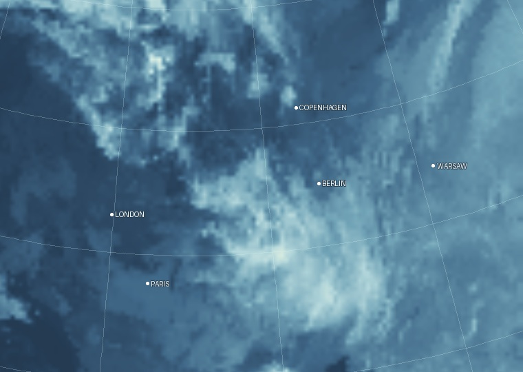

# CloudVision

CloudVision classifies satellite infrared observations, maps ten cloud types and four surface types, and estimates the share of observed pixels covered by each. This distribution includes the 252 paired European scenes, four trained PyTorch models, eight experiment histories, and everything needed to run inference offline after installation.



## Run the dashboard

With Docker Engine and Compose v2 running, build the shared CPU image and start the services.

```bash
docker compose build api
docker compose up
```

Open [the dashboard](http://localhost:8501) or [the interactive API documentation](http://localhost:8000/docs). Choose **Analyze an observation**, pick an example and select **Run analysis**. **Segmentation explorer** lets you compare the overlay with the original and inspect a pixel. **Download results** exports the mask, overlay, statistics and model metadata. Shut down with `docker compose down`.

### Local Python

Use Python 3.12 on Linux, macOS for serving, or WSL2. Training uses a POSIX file lock. The Linux x86-64 CPU installation used for this release is below. On macOS install the standard PyTorch wheel through the requirements file. For GPU training install the matching PyTorch 2.8.0 CUDA build before the other requirements.

```bash
python3.12 -m venv .venv
source .venv/bin/activate
python -m pip install torch==2.8.0 --index-url https://download.pytorch.org/whl/cpu
python -m pip install -r requirements.txt
python -m uvicorn api.main:app --host 127.0.0.1 --port 8000
```

In a second terminal in the same directory, activate the environment and run the dashboard.

```bash
source .venv/bin/activate
python -m streamlit run app/dashboard.py
```

## Measured performance

The residual U-Net earned the highest validation mIoU. On 39 held-out November–December scenes it achieved **0.206 mIoU**, **0.323 mean Dice** and **39.3% pixel accuracy**. The CNN achieved **0.277 macro F1** on dominant-cloud classification. The residual U-Net labeled **74.9% of reference surface pixels** as cloud. These results describe a research benchmark with substantial cloud-cover error.

[Full benchmark with per-class and temporal analysis](docs/CloudVision-Benchmark.pdf)

## Analyze a file

Upload a two-dimensional floating-point Kelvin NPY, or a single-plane unsigned 16-bit PNG/TIFF stored in centikelvin. Values range from 150 to 350 K. NaN in NPY and zero in PNG/TIFF mark missing observations. Each side must be 16–1024 pixels. The file limit is 8 MiB. Use brightness temperature from a compatible near-11 µm infrared window channel. The service returns a 422 response for RGB photographs, corrupt files or uncalibrated values.

```bash
curl --fail -F file=@examples/20170107T1800Z.png -F model=unet_plus \
  -F mc_passes=1 -F include_maps=false http://localhost:8000/predict > result.json
python -c 'import json; print(json.load(open("result.json"))["summary"])'
```

| Endpoint | Result |
|---|---|
| GET /health | Availability of the registered model files |
| GET /models | Architecture, version, training data, preprocessing and default model |
| POST /predict | Summary, classes, base64 PNG outputs, CSV, model and input provenance |
| GET /metrics | Frozen held-out benchmark, latency, calibration and error analysis |
| GET /docs | Swagger UI with request and response examples |

Set `model` to `cnn`, `unet`, `unet_plus` or `segformer`. Omitting it selects the segmentation model with the highest validation mIoU. Segmentation preserves input dimensions and includes cloud coverage. The CNN returns a whole-image probability distribution and Grad-CAM. Use `mc_passes=2..12` to average stochastic dropout predictions. `include_maps=false` omits the fourteen per-class probability images.

Mask codes 0–3 denote surfaces, 4–13 denote clouds, and 255 denotes missing input. Continuous PNGs use 0 for missing and decode as `(code - 1) / 65534`. The JSON and PNG metadata record input checksum, model version, preprocessing, dimensions and spatial transform. Inputs remain in request/session memory. Configuration and a Python batch-inference example are in [the architecture guide](docs/architecture.md).

## Reproduce the experiments

The bundled data, checkpoints and benchmark can be used immediately. Run the following from the project root.

```bash
python -m pip install -r requirements-dev.txt
python -m scripts.audit
python -m pytest -q
python -m src.train --workdir reproduction --freeze
python -m src.evaluate --workdir reproduction
```

The reproduction directory keeps new results separate from the packaged benchmark. Repeating an interrupted command resumes its last completed epoch. `--only cnn` runs the image baseline. `--set epochs=20 optimizer=adam lr=0.0007` overrides YAML settings for a new work directory. On a compatible Colab runtime, upload and unzip the archive, change into CloudVision, install the requirements and run the same commands in notebook shell cells. Enable a GPU runtime and install matching PyTorch for CUDA. The shipped benchmark used CPU.

To reconstruct inputs from public sources, run the acquisition and alignment check. Both operations cache source downloads. The downloader accepts a different year, month/day/hour sample or 768-pixel native crop.

```bash
python -m scripts.fetch_pairs --out data/rebuilt --cache data/raw
python -m scripts.check_alignment --cache data/raw --compare-data data/rebuilt
```

Compare scientific array hashes by scene in the two manifests. The NOAA full-NetCDF fallback and OPeNDAP subset give the same measurements and can have different source-response hashes. Pass the same data directory to training and evaluation.

Regenerate the PDF, model cards and Markdown comparison for the bundled benchmark with `python -m scripts.report`. The eight run records include epoch-level losses, learning rates and validation scores. Import them into MLflow with `python -m scripts.mlflow_runs`. Use `--workdir reproduction` to import a newly trained experiment directory. Repeating the import skips previously recorded checkpoints. If a full MLflow server is installed, use `mlflow ui --backend-store-uri ./mlruns` and open its local URL. The JSON run records work independently of MLflow.

## Inside the release

| Location | Contents |
|---|---|
| data/processed | Per-scene observation/mask pairs, UTC manifest, hashes and provenance |
| src, configs, scripts | Preprocessing, augmentation, models, training, calibration, evaluation, registry and acquisition |
| checkpoints | Four versioned, checksum-verified deployment weights |
| experiments | Eight best checkpoints and run histories, held-out metrics, data and alignment audits, representative figures |
| app, api | Six-page Streamlit workspace and FastAPI service |
| notebooks | Four executable notebooks for exploration, preprocessing, CNN and comparison |
| docs | Dataset card, technical methodology, architecture, limitations, model cards, comparative report and recorded walkthrough |
| tests, .github/workflows | Automated validation, training/inference checks, HTTP and app integration, container CI |

[Benchmark report](docs/CloudVision-Benchmark.pdf) · [Measured results](docs/experiments.md) · [Methodology](docs/methodology.md) · [Dataset card](docs/data-card.md) · [Model cards](docs/model-cards.md) · [Limitations](docs/limitations.md) · [Demo video](docs/CloudVision-Demo.mp4)

## Attribution

CloudCast supplies the reference classes. NOAA GridSat-B1 supplies the independent infrared measurements. Data and released weights are available under CC BY-NC-SA 4.0. The original software carries the MIT license. [Dataset references and terms](NOTICE.md)
